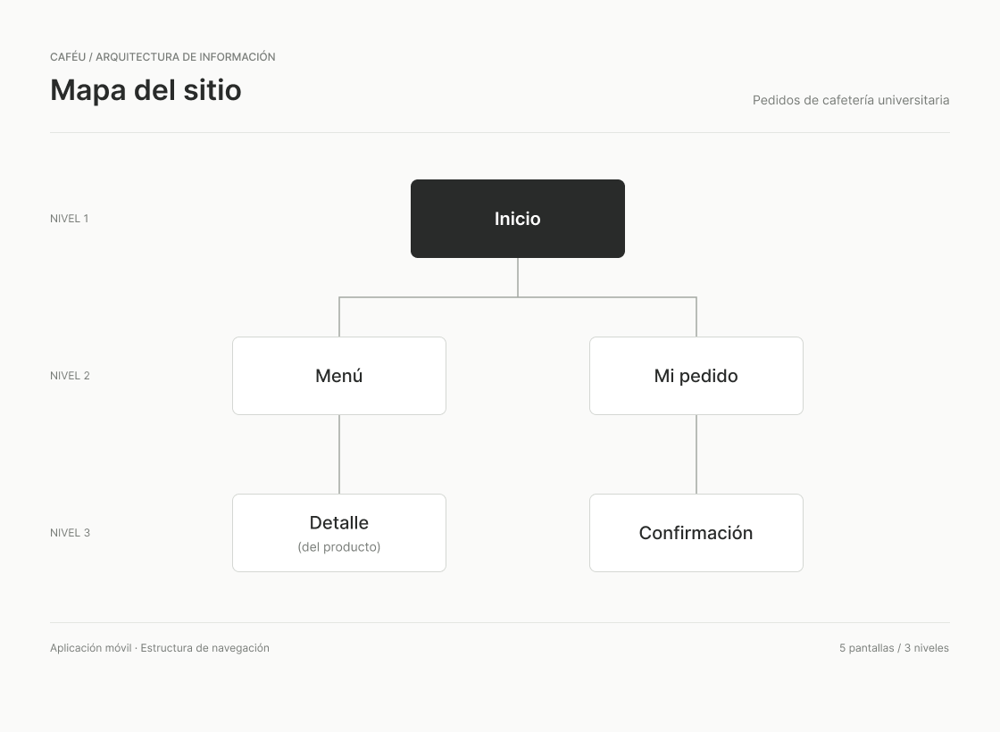

# 🗺️ Mapa del Sitio (Sitemap) - CaféU

## Descripción
Este documento presenta la arquitectura de información para la aplicación móvil de **CaféU**. El objetivo de este sitemap es organizar las secciones principales de la aplicación de forma lógica, permitiendo que el estudiante encuentre el menú y gestione su pedido rápidamente.

## Diagrama del Sitemap
A continuación se muestra el diagrama visual con la estructura de navegación jerárquica de la aplicación:

 
## Estructura de Navegación
La aplicación está organizada en 3 niveles principales para garantizar una navegación fluida y sin distracciones:

* **Nivel 1 (Raíz):** 
  * **Inicio:** Pantalla principal al abrir la aplicación.
* **Nivel 2 (Secciones principales):**
  * **Menú:** Catálogo de productos disponibles en la cafetería.
  * **Mi pedido:** Pantalla del "carrito" donde el estudiante revisa el resumen de su orden.
* **Nivel 3 (Vistas detalladas y de estado):**
  * **Detalle (del producto):** Vista que se despliega desde el Menú para ver información específica de un artículo seleccionado.
  * **Confirmación:** Pantalla final que aparece tras aceptar "Mi pedido", la cual muestra la señal clara de que la orden fue recibida por la cafetería.