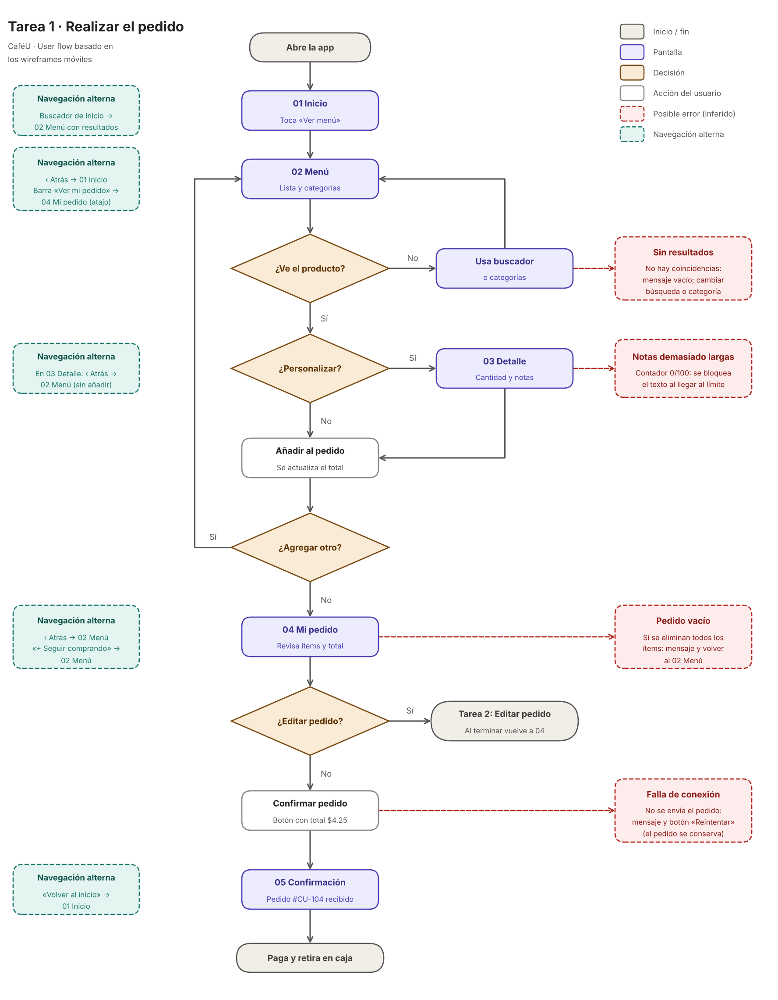
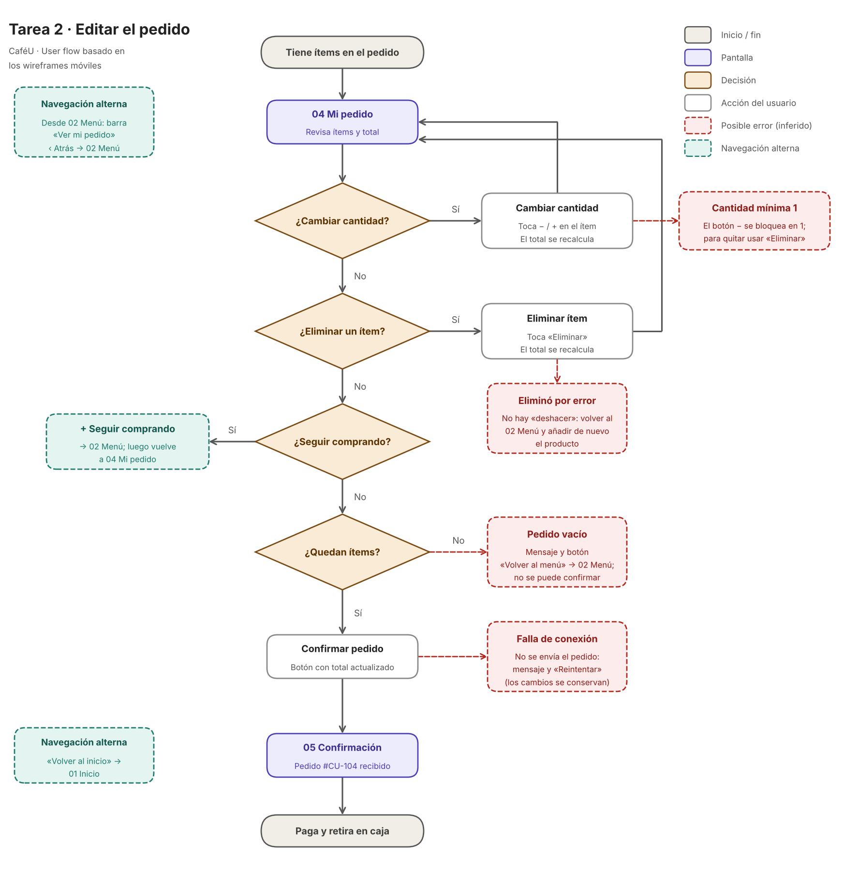

# CaféU · User flow por tareas

Este documento divide el user flow de CaféU en **dos tareas** que el usuario realiza en la app. 

**Leyenda de los diagramas**

- Gris: inicio / fin.
- Violeta: pantalla.
- Naranja: decisión.
- Blanco: acción del usuario.
- Verde punteado: navegación alterna.
- Rojo punteado: posible error.

---

## Tarea 1 · Realizar el pedido

### Por qué es importante

Es la tarea central del producto: sin ella, la app no cumple su promesa («Evita la fila: pide tu café aquí»). Cada fricción en este camino se traduce directamente en ventas perdidas o en usuarios que vuelven a hacer fila. Además, es la primera experiencia del usuario con la app, por lo que define si la vuelve a usar.

### Recorrido paso a paso

1. **Abre la app → 01 Inicio.** Ve el saludo y el banner. Toca **Ver Menú**.
2. **02 Menú.** Explora la lista de productos y las categorías.
3. **¿Ve el producto?**
   - **No:** usa el buscador o cambia de categoría y vuelve al menú.
   - **Sí:** continúa.
4. **¿Personalizar?**
   - **Sí:** entra a **03 Detalle**, ajusta cantidad y escribe instrucciones especiales (por ejemplo, «sin azúcar») y luego añade.
   - **No:** toca **Añadir** directamente en la tarjeta del menú.
5. **Añadir al pedido.** Se actualiza el total en la barra inferior (en el wireframe: «2 ítems · $4.25»).
6. **¿Agregar otro?**
   - **Sí:** vuelve a **02 Menú** y repite desde el paso 2.
   - **No:** toca **Ver mi pedido**.
7. **04 Mi pedido.** Revisa ítems y total. Si necesita cambiar algo, pasa a la **Tarea 2**.
8. **Confirmar pedido** (botón con el total, por ejemplo $4.25).
9. **05 Confirmación.** Ve «¡Pedido recibido!» y el número `#CU-104`.
10. **Fin: paga y retira en caja** en aproximadamente 5–10 minutos.

### Acciones, decisiones y posibles errores

| Tipo | Elemento | Detalle |
|---|---|---|
| Acción | Tocar «Ver Menú» | Entra al catálogo |
| Acción | Buscar / filtrar por categoría | Localiza el producto |
| Acción | Añadir (tarjeta) o Añadir al pedido (detalle) | Suma el producto al pedido |
| Acción | Confirmar pedido | Envía el pedido |
| Decisión | ¿Ve el producto? | No → buscador o categorías |
| Decisión | ¿Personalizar? | Sí → 03 Detalle |
| Decisión | ¿Agregar otro? | Sí → vuelve a 02 Menú |
| Decisión | ¿Editar pedido? | Sí → Tarea 2 |
| Error | Sin resultados en la búsqueda | Mostrar mensaje vacío y sugerir cambiar la búsqueda o la categoría |
| Error | Notas demasiado largas | Contador 0/100: bloquear el texto al llegar al límite |
| Error | Pedido vacío | Si se eliminan todos los ítems, avisar y volver al menú |
| Error | Falla de conexión al confirmar | Mensaje y botón «Reintentar», sin perder el pedido |

### Alternativas de navegación

- **Buscador desde 01 Inicio:** lleva al Menú con resultados, sin pasar por «Ver Menú».
- **‹ Atrás en 02 Menú:** regresa a 01 Inicio.
- **Barra inferior «Ver mi pedido» en 02 Menú:** atajo directo a 04 Mi pedido.
- **‹ Atrás en 03 Detalle:** regresa al Menú sin añadir el producto.
- **‹ Atrás y «+ Seguir comprando» en 04 Mi pedido:** vuelven al Menú.
- **«Volver al inicio» en 05 Confirmación:** regresa a 01 Inicio.

---

## Tarea 2 · Editar el pedido

### Por qué es importante

Pocas personas aciertan a la primera: se equivocan de producto, de cantidad o cambian de opinión. Si corregir el pedido es difícil, abandonan antes de confirmar. Una edición clara y segura da confianza, reduce errores en la caja y evita pedidos que luego hay que corregir en persona.

### Recorrido paso a paso

1. **Punto de partida:** el usuario ya tiene ítems y está en **04 Mi pedido** (Tarea 1, paso 7).
2. **Revisa** cada ítem, su cantidad, su precio y el total del resumen.
3. **¿Cambiar cantidad?**
   - **Sí:** toca **−** o **+** en el ítem; el subtotal y el total se recalculan.
4. **¿Eliminar un ítem?**
   - **Sí:** toca **Eliminar**; el ítem desaparece y el total se recalcula.
5. **¿Seguir comprando?**
   - **Sí:** toca **«+ Seguir comprando»**, va al Menú, añade más y vuelve a 04 Mi pedido.
6. **¿Quedan ítems?**
   - **No:** se muestra el pedido vacío y no se puede confirmar.
   - **Sí:** continúa.
7. **Confirmar pedido** con el total actualizado.
8. **05 Confirmación** y fin del recorrido: «Paga y retira en caja».

Cada cambio devuelve al usuario a **04 Mi pedido**, de modo que puede encadenar varias ediciones antes de confirmar.

### Acciones, decisiones y posibles errores

| Tipo | Elemento | Detalle |
|---|---|---|
| Acción | Tocar − / + | Cambia la cantidad del ítem |
| Acción | Tocar «Eliminar» | Quita el ítem del pedido |
| Acción | Tocar «+ Seguir comprando» | Va al Menú para añadir más |
| Acción | Confirmar pedido | Envía el pedido ya corregido |
| Decisión | ¿Cambiar cantidad? | Sí → − / + |
| Decisión | ¿Eliminar un ítem? | Sí → Eliminar |
| Decisión | ¿Seguir comprando? | Sí → 02 Menú |
| Decisión | ¿Quedan ítems? | No → pedido vacío |
| Error | Cantidad mínima 1 | El botón − se bloquea en 1; para quitar el producto se usa «Eliminar» |
| Error | Eliminó por error | En el wireframe no hay «deshacer»: hay que volver al Menú y añadirlo de nuevo. **Recomendación:** agregar «Deshacer» |
| Error | Pedido vacío | Mensaje y botón «Volver al menú»; no se puede confirmar |
| Error | Falla de conexión al confirmar | Mensaje y «Reintentar», conservando los cambios |

### Alternativas de navegación

- **Entrada a 04 Mi pedido** desde la barra «Ver mi pedido» de 02 Menú, o desde Añadir al pedido tras terminar de elegir.
- **‹ Atrás en 04 Mi pedido:** regresa al Menú.
- **«+ Seguir comprando»:** va al Menú y luego regresa a 04 Mi pedido con los cambios.
- **«Volver al inicio» en 05 Confirmación:** regresa a 01 Inicio.

---

## Cómo se conectan las dos tareas

La Tarea 2 es un **desvío opcional** dentro de la Tarea 1: nace en la decisión «¿Editar pedido?» de 04 Mi pedido y siempre regresa a esa misma pantalla antes de confirmar. Por eso 04 Mi pedido es la pantalla clave del flujo: reúne la revisión, la edición y la confirmación.

