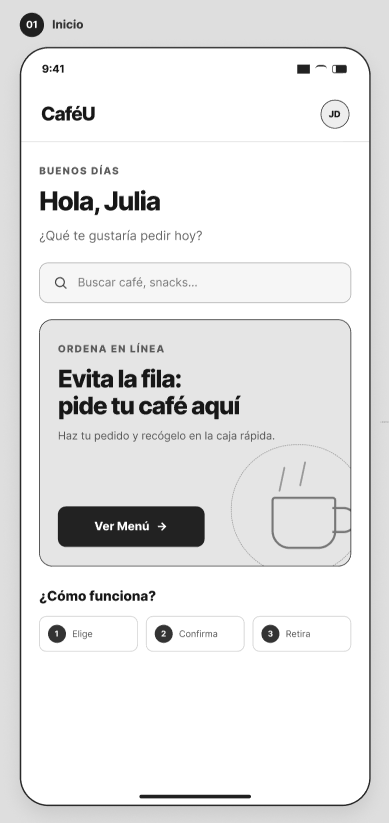
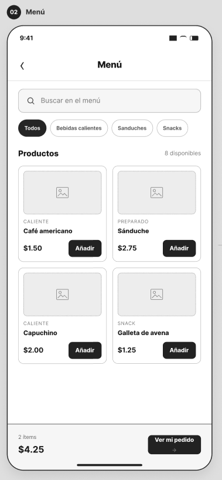
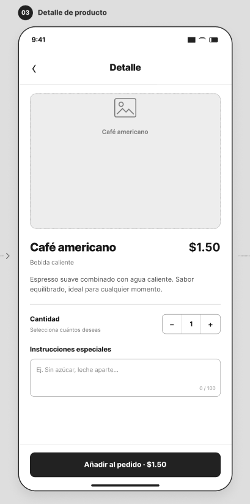
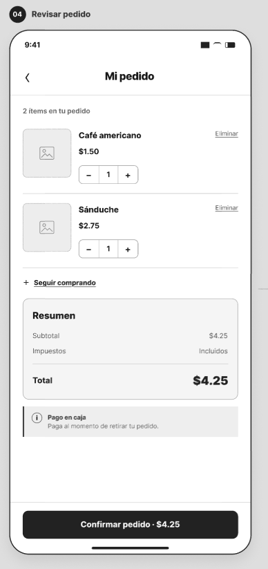
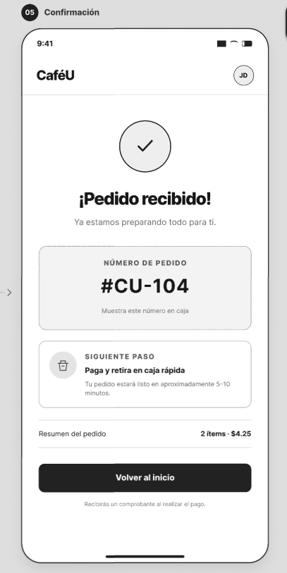

# APE 4 - Fase 1: Wireframes de Baja Fidelidad y Componentes

## Descripción
> En esta sección se detallan los wireframes de baja fidelidad para el flujo de pedidos de la cafetería universitaria (CaféU), identificando los componentes interactivos clave de cada pantalla para asegurar una experiencia de usuario clara y directa.

---
Enlace al prototipo de Figma: https://www.figma.com/proto/0gS190p74dFGIG9LUkS6WE/Sin-t%C3%ADtulo?node-id=0-1&t=d68GzhFL1flgQdPi-1

## Detalle de Pantallas y Componentes

### 1. Pantalla de Inicio
* **Objetivo:** Dar la bienvenida al usuario y ofrecer accesos rápidos.
* **Componentes:**
  - Título institucional ("CaféU - Menú del día").
  - Eslogan enfocado en rapidez ("Pedido rápido para tu descanso").
  - Botones de navegación principal: *Ver menú* y *Mi pedido*.

### 2. Pantalla de Menú
* **Objetivo:** Permitir la búsqueda y exploración de productos disponibles.
* **Componentes:**
  - Barra de búsqueda superior.
  - Tarjetas de productos estructuradas con nombre y precio (Ej. *Café americano - $1.50*, *Sánduche - $2.75*).
  - Indicador flotante o de estado del carrito (*Mi pedido: X*).

### 3. Pantalla de Detalle de Producto
* **Objetivo:** Mostrar información detallada del artículo seleccionado y permitir personalizar la cantidad.
* **Componentes:**
  - Título y precio del producto seleccionado.
  - Control de cantidad interactivo (`[-]` / `[+]`).
  - Botón de acción principal: *Agregar al pedido*.

### 4. Pantalla de Mi Pedido (Revisión)
* **Objetivo:** Permitir al usuario revisar los productos elegidos, modificar cantidades o eliminar artículos antes de pagar.
* **Componentes:**
  - Listado de productos seleccionados con su respectivo precio unitario.
  - Controles de edición (*Cantidad* y botón *Quitar*).
  - Cálculo del *Subtotal*.
  - Opciones secundarias y de confirmación: *Seguir comprando* y *Confirmar pedido*.

### 5. Pantalla de Confirmación
* **Objetivo:** Informar al usuario que su transacción o envío de pedido ha sido exitoso.
* **Componentes:**
  - Mensaje destacado de éxito ("¡Pedido recibido!").
  - Resumen del ticket (Número de pedido y detalle, ej. *Pedido #CU-104*).
  - Botón de salida para reiniciar el ciclo (*Volver al menú*).

